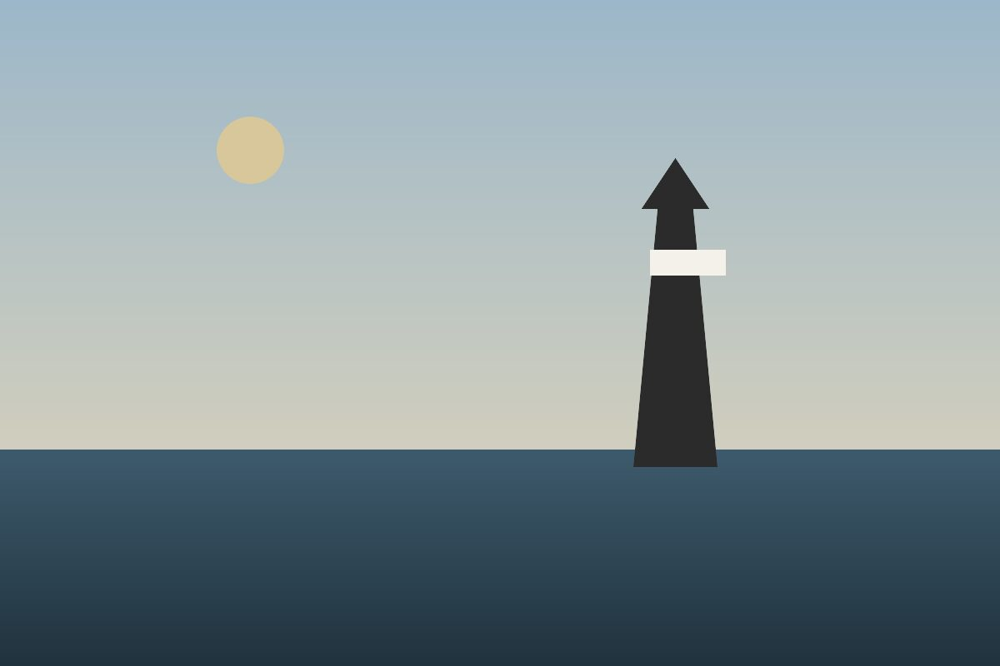
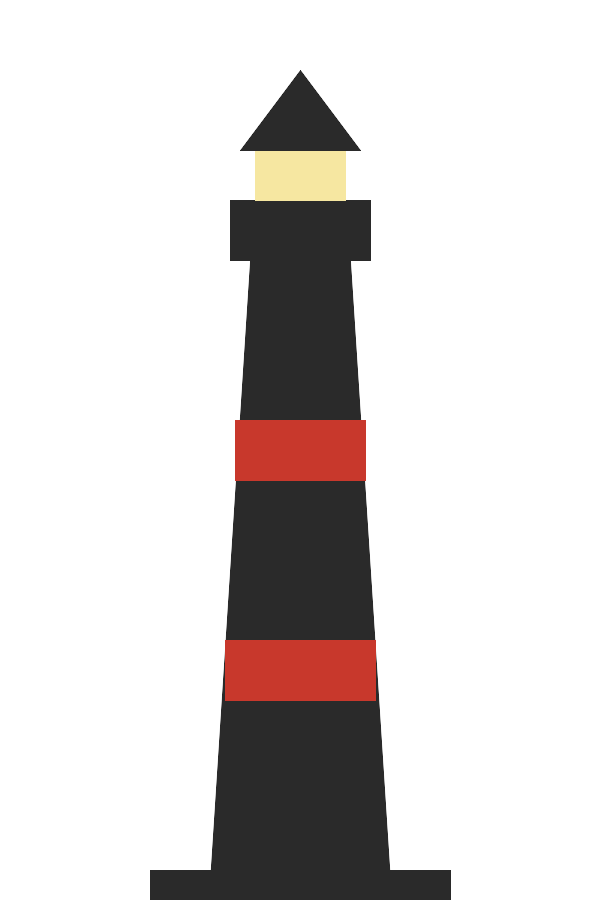

= The Last Keepers of Gull Point: Two families kept one light burning for ninety years. Then the light no longer needed them.
Mara Lindqvist
:look: magazine
:lang: en
:figure-caption!:
:kicker: Coastlines
:credit: Photographs by Tomas Ferreira • Drawings by the author
:issue: Vol. 3, No. 9

// A feature that uses every part of a piece (doc/magazine.md), for the
// magazine looks' reference renderings. The text and the people in it
// are invented; the images are generated.

[#gull-point.lede.dropcap,reftext=The Last Keepers]
[.dateline]#Gull Point, Maine —# On the last night the lamp was tended by hand, Ellen Marsh climbed the ninety-one iron steps of the tower the way her grandmother had taught her, counting them under her breath, one hand on the cold rail and the other holding a can of kerosene she no longer needed. The automatic beacon had been running for a week. It flashed white every six seconds, as the old lens had, and nobody on the water could tell the difference. She could.

“You learn the light the way you learn a voice,” she said, sitting on the gallery with her back to the glass, the bay below her going from slate to black. “The new one is correct. It is not wrong about anything. It just doesn't hesitate.”

For ninety years the Marsh and Okafor families kept the light at Gull Point between them, handing the keys across a kitchen table every spring and every fall. They logged the weather four times a day, painted the tower every third summer, and rowed out to the ledge after storms to count what the sea had taken. The logbooks, forty-two of them bound in oilcloth, now sit in a climate-controlled room in Augusta. The tower sits where it always has.

[.jump]
<<keepers-more>>

[.pullquote]
____
The new one is correct. It is not wrong about anything. It just doesn't hesitate.
____

== A ledge, a lamp and a log

.[.caption-lead]#The point at dusk.# The tower from the south beach, an hour before the beacon starts.

The light was built in 1871 after the schooner _Abigail Rowe_ broke up on the outer ledge with her crew of six. The town petitioned for a lamp for nine years before one came; the petition, written in a careful hand and signed by every household on the point, hangs framed in the keeper's house beside a barometer that has not been set since 1962.

The first keeper was a carpenter named Josiah Marsh, who had helped build the tower and was offered the post because he knew where every bolt went. His log for the first winter runs to two hundred pages. Most entries are a line long: the wind, the sea, the hours the lamp burned, the oil it used. A few are not. On the ninth of February he wrote that a seal had hauled out on the landing and would not be moved, and that he had decided, after some consideration, to let it stay.

[.columns]
== What the logbooks remember

The logbooks are the reason anyone outside the town knows the light's name. Historians of the coast read them for the weather, which they record more steadily than any other source for a hundred miles. Ornithologists read them for the birds: the Okafor keepers in particular wrote down every flock that struck the glass in the autumn migration, with the species where they could tell it and a careful sketch where they could not.

.[.caption-lead]#The tower.# A keeper's drawing from the 1931 log, traced.

Ellen's grandmother, Ruth Marsh, kept the light through the war, when the lamp was dimmed and then darkened entirely for two years. Her entries from those years are the longest in all forty-two books. With no light to tend she tended the log, writing about the convoys she could see on clear days, the fishermen who stopped coming in, and the long silence of a coast told to keep itself dark.

“She used to say the log was the real light,” Ellen said. “The lamp told ships where the rocks were. The log told everybody else where we were.”

****
.Keeping a light
The keeper's day, as the 1931 instructions set it out:

* Light the lamp at sunset; trim the wick at midnight and at four.
* Record wind, sea and visibility at eight, noon, four and eight.
* Polish the lens daily; never with the hand bare.
* Report any vessel in distress by the quickest means at hand.
****

When the Coast Guard announced in the spring that Gull Point would be automated, the town held a meeting in the grange hall. Ninety people came, more than had come to anything since the school closed. Nobody argued against the change; the beacon was cheaper and, by every measure that could be written down, better. What they wanted to talk about was the house, the tower and the books, and who would look after them when nobody had to.

[#keepers-more]
== The house, the tower and the books

[.jump]
<<gull-point>>

The answer, for now, is a trust of eleven volunteers, Ellen among them, who open the tower on summer weekends and keep a new log of their own. It records visitors instead of vessels and the weather only when it is interesting. Children are allowed to climb to the gallery and look at the lens, which no longer turns.

Samuel Okafor, whose father kept the light for twenty-six years, is the trust's treasurer. He keeps its accounts in a ledger bound like the old logs, in oilcloth, because he says it seemed wrong to keep them any other way. “Nobody asked for that,” he said. “But somebody's going to read this in a hundred years, and they'll want it to look like it belongs.”

[.end]
On the night of the last hand-tended light, Ellen stayed on the gallery until the automatic beacon took over at sunset. She did not light the lamp. She opened the log, wrote the time, the wind and the sea, and under them a single line: _Light correct. Keeper relieved._
